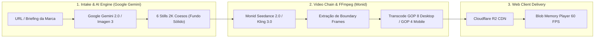
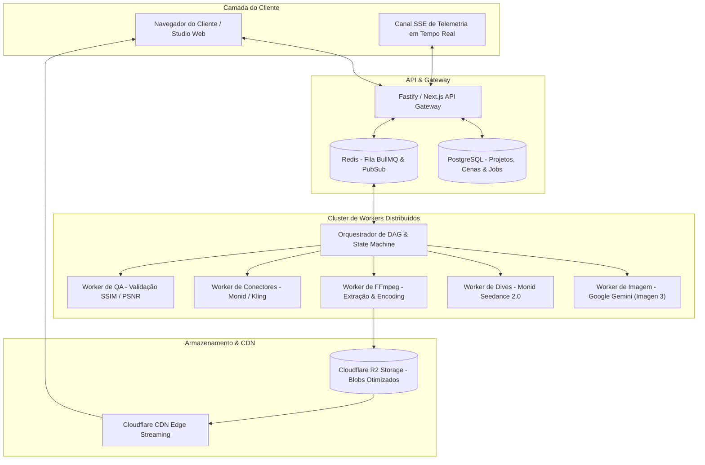
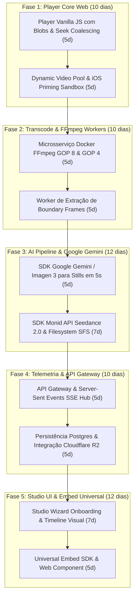

# Plano Executivo & Técnico: Construção e Validação da Aplicação Web ScrollWorld

Este plano detalha o roteiro técnico e executivo para construir, validar e garantir a estabilidade e performance do motor do `/scroll-world` operando dentro de uma aplicação web moderna, escalável e resiliente a falhas, utilizando **Google Gemini (Imagen 3)** para geração de imagens e **Monid (ByteDance Seedance 2.0 / Kling 3.0)** para a cadeia contínua de vídeo.

---

## 1. Visão Executiva & Objetivos de Validação

O objetivo principal desta fase é **garantir o funcionamento 100% confiável do ecossistema ScrollWorld na Web**, com geração ultra-rápida de imagens via Google Gemini, encadeamento de vídeo contínuo sem cortes (*frame-locked*), sem travamentos de memória em smartphones e com auto-cura de falhas de IA.

---

## 2. Matriz de Riscos & Antecipação de Falhas Críticas

| Risco Crítico | Impacto no Usuário | Causa Raiz Técnica | Estratégia de Mitigação Arquitetural |
| :--- | :--- | :--- | :--- |
| **Lentidão no Onboarding de Imagens** | Usuário desiste durante a espera de 3 minutos para ver o roteiro. | Modelos legados geram imagens em 60-180s com filas lentas. | **Google Gemini (Imagen 3 API):** Geração paralela de todas as 6 cenas em **menos de 8 segundos** com custo irrisório (~$0.03/imagem). |
| **Falso-Positivo NSFW na IA de Vídeo** | Geração interrompida ou vídeo ausente. | Modelos de difusão de vídeo (`seedance_2_0`) bloqueiam termos legítimos (ex: "quarto", "spa", "água", "vinho"). | **Estratégia em 3 Níveis:** 1. Sanitização automática do prompt (*"empty, unoccupied, architectural"*). 2. Failover multi-provedor para **`kling3_0`** com os mesmos frames de entrada. 3. Degradação graciosa: conector `null` no JSON com crossfade direto no player. |
| **Descontinuidade Visual (*Seam Pop*)** | Salto brusco na transição entre cenas. | Usar o still estático em vez dos frames reais decodificados do vídeo. | **Worker de FFmpeg dedicado:** Extrai os frames reais do arquivo gerado (`-sseof -0.15` e `-ss 0`). Módulo de QA calcula métricas **SSIM ($>0.88$) e PSNR ($>27\text{ dB}$)** antes de liberar a publicação. |
| **Crash de Memória / GPU em Smartphones** | Aba fecha ou recarrega no iPhone/Android. | Decodificação simultânea de múltiplos vídeos 1080p na memória gráfica. | **Mobile-First Pipeline:** 1. Encodings nativos 720p verticais com **GOP 4** (`-g 4 -keyint_min 4`). 2. **Dynamic Video Pool:** No máximo 2 elementos `<video>` instanciados no DOM simultaneamente. 3. Descarte ativo de Blobs (`URL.revokeObjectURL`) fora do raio de visualização. |
| **Vídeo Congelado no Frame 0** | Página trava e não responde ao scroll. | Servidor web sem suporte a *HTTP 206 Partial Content* (Byte-Range requests), fixando `video.seekable = [0,0]`. | **In-Memory Blob Streaming:** O player faz `fetch(url) -> blob() -> URL.createObjectURL(blob)`, tornando o vídeo $100\%$ seekável em memória RAM em qualquer host. |
| **Engasgos em Scrolls Rápidos (*Flicks*)** | Vídeo pisca ou trava temporariamente. | Requisições concorrentes de `currentTime` sobrecarregam o decodificador de hardware. | **Seek Coalescing:** O motor ignora novas buscas enquanto `video.seeking === true`, permitindo que o lerp convirja suavemente. |
| **Tela Preta no iOS Safari** | Primeiro frame não renderiza ao abrir. | WebKit exige interação do usuário antes de decodificar vídeos mudos. | **iOS Priming:** Executa um `v.play().then(pause)` silencioso no primeiro toque e mantém o still 2K do Gemini como poster até o evento `seeked` confirmar o primeiro frame pintado. |

---

## 3. Arquitetura de Sistemas & Pipeline de Execução

---

## 4. Tabela de Custos & Unit Economics Atualizada (Google Gemini)

| Componente da Cadeia | Provedor & Modelo | Resolução / Duração | Custo Unitário | Custo por Projeto ($N=6$) |
| :--- | :--- | :--- | :--- | :--- |
| **6 Scene Stills** | **Google Gemini (Imagen 3)** | 2K (3:2 / 16:9 / 9:16) | **$0.03 / still** | **$0.18** *(vs $1.50 anterior)* |
| **Previz Draft 480p** | Monid `seedance-2.0` (480p) | 480p (6 dives + 5 conn) | $0.28 dive / $0.35 conn | **$3.43** |
| **Desktop 1080p Final** | Monid `seedance-2.0` (1080p) | 1080p (6 dives + 5 conn) | $2.99 dive / $1.87 conn | **$27.29** |
| **Mobile 9:16 Portrait** | Monid `seedance-2.0` (9:16) | 720p vertical | $1.21 dive / $0.76 conn | **$11.06** |
| **Processamento & CDN** | FFmpeg Worker + Cloudflare R2 | H.264 / GOP 8 / GOP 4 | Transcode serverless | **$0.20** |
| **TOTAL COGS MASTER** | — | — | — | **~$42.16** *(Margem bruta > 57% no pacote de $99)* |

---

## 5. Roteiro Passo a Passo de Implementação (5 Fases Técnicas)

### Fase 1: Motor do Player Web & Gestão de Mídia (Sandbox do Cliente)
- Implementar o núcleo do player em TypeScript com:
  - Carregamento de clipes via `Blob` em memória.
  - Loop de interpolação `requestAnimationFrame` com taxa de amortecimento $0.18$.
  - Mapeamento cúbico de desaceleração central (`lingerEase`).
  - **Dynamic Video Pool:** Limitar o DOM a no máximo 2 elementos `<video>` ativos, descartando instâncias fora do raio de $\pm 1.6\,\text{vh}$.
  - Mecanismo de *Seek Coalescing* e *iOS Safari Priming* no primeiro evento de touch.

### Fase 2: Microsserviço de Transcodificação & FFmpeg Workers
- Criar container Docker leve com binários otimizados de FFmpeg/FFprobe:
  - Encoding Desktop: 1080p, CRF 20, Preset Slow, GOP fixo `-g 8 -keyint_min 8`, `-sc_threshold 0`, filtro `unsharp=5:5:0.8:5:5:0.0`, `+faststart`.
  - Encoding Mobile Nativo: 720p vertical (`720x1280`), CRF 23, GOP `-g 4 -keyint_min 4`, `unsharp=5:5:0.6:5:5:0.0`.
  - Módulo de extração de frames de fronteira: `-sseof -0.15` (último frame) e `-ss 0` (primeiro frame).
  - Algoritmo BFS Flood-fill em Python para recorte de fundo transparente (`knockout.py`).

### Fase 3: Pipeline de IA com Google Gemini & Monid API
- **Worker de Imagens Google Gemini:**
  - Implementação via SDK oficial `@google/genai` (Node.js/Python) utilizando `imagen-3.0-generate-002` / Gemini 2.0 Flash.
  - Geração paralela de 6 stills em ~5 segundos, com suporte nativo a proporções 16:9, 3:2 e 9:16.
- **Worker de Vídeo Monid:**
  - Integração com a API Monid (`bytedance /v1/video/seedance-2.0`) utilizando upload SFS e polling assíncrono a cada 8s.
  - Sanitização de prompts e failover multi-provedor para o **Kling 3.0** em caso de falso positivo NSFW.

### Fase 4: Gateway de API, Telemetria SSE & Storage R2
- Estruturar o backend com Fastify/NestJS e PostgreSQL (via Prisma ORM).
- Canal de telemetria em tempo real via **Server-Sent Events (SSE)** informando progresso percentual, custo de tokens acumulado e pré-visualização instantânea.
- Pipeline de upload para bucket **Cloudflare R2** com cabeçalhos de cache imutável e CDN global com saída de dados gratuita.

### Fase 5: Studio No-Code & SDK de Distribuição Universal
- Interface de autoria no **Next.js 15**:
  - Wizard de Onboarding com extração de paleta e tom de voz a partir da URL da marca.
  - Timeline visual de scroll com ajuste interativo de `diveScroll` e `linger`.
  - Visualizador Dual-Mode Desktop (16:9) e Mobile (9:16).
- SDK de distribuição universal:
  - Script loader ultra-leve `embed.js` (< 12KB gzip).
  - Web Component nativo `<scroll-world>` isolado via Shadow DOM.
  - Pacote para React/Next.js (`@scrollworld/react`).

---

## 6. Plano de Verificação & Critérios de Aceite (QA Gates)

### 6.1. Testes Automatizados de Pipeline
- **Teste de Latência do Gemini**: Validar que a geração das 6 imagens em paralelo é concluída em menos de 10 segundos.
- **Teste de GOP e Seekability**: Validar via `ffprobe` se todos os vídeos de saída possuem exatamente `keyint = 8` (Desktop) e `keyint = 4` (Mobile).
- **Teste de Coerência de Seams**: Módulo automatizado calcula SSIM e PSNR entre a junção de cada Dive e Conector. O pipeline só aprova se $\text{PSNR} \ge 27\text{ dB}$ ou $\text{SSIM} \ge 0.88$.
- **Teste de Custo e Timeout**: Simular falhas de rede na API Monid e verificar se o exponential backoff e o failover para o Kling disparam sem intervenção humana.

### 6.2. Testes de Performance no Cliente (Browser & Mobile)
- **Teste de 60 FPS com Throttling**: Executar o player em dispositivo móvel emulado com CPU throttled 4x e 6x. O scroll deve responder sem congelamento de decodificador.
- **Teste de Memória RAM / GPU**: Monitorar o heap de memória durante a navegação contínua por 10 cenas; o consumo deve permanecer abaixo de $120\text{ MB}$.
- **Teste de Safari iOS**: Confirmar ausência de tela preta e verificar que o poster estático é substituído suavemente pelo vídeo no primeiro frame decodificado.
